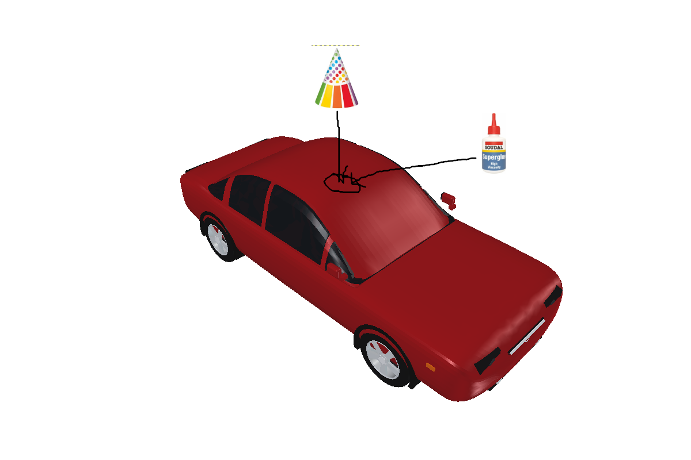

# hondahat

## SPECIFICATIONS

A complete, tested, fully open source hardware, road-legal car.

Capable of driving up to 120mph on road.

Capable of operating outdoors including in heavy rain and snow.

Build cost 102-20010 USD

## BILL OF MATERIALS

1. A Honda civic (closed source available component, supplier: Honda.  Used price 100-20000 USD, any model)

2. Party hat (closed source available component, supplier: Amazon, price 1-5USD, any model)

3. Superglue (close source available component, supplier: Amazon, price 1-5USD, any model)

## TOOLS REQUIRED

None

## SKILLS AND LABOUR REQUIRED

Gluing, 5 seconds

## BUILD INSTRUCTIONS

1. Glue the party hat onto the Honda Civic as shown in fig. 1.

Fig 1:

## USER INSTRUCTIONS

Drive the car according to the Honda Civic component's instructions.

## LICENCE

CERN-OSH-W

